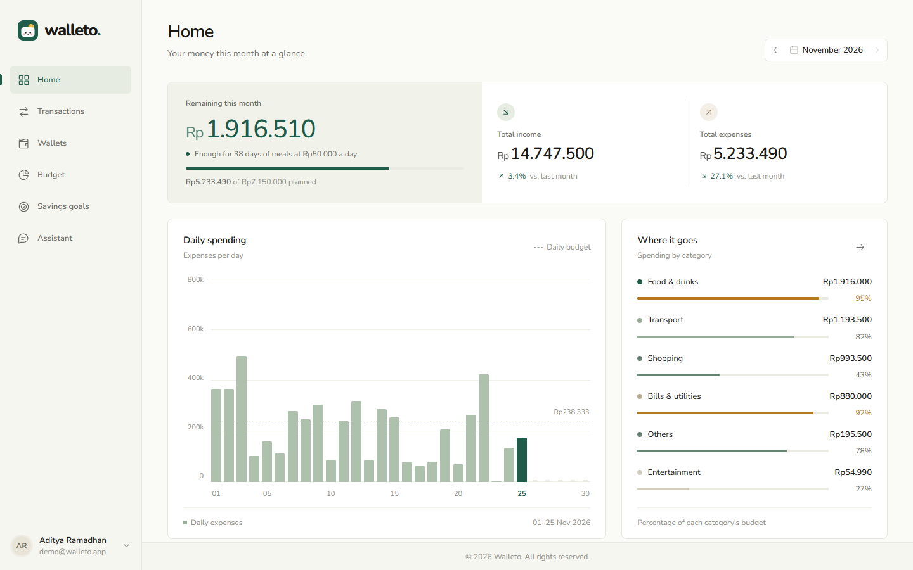
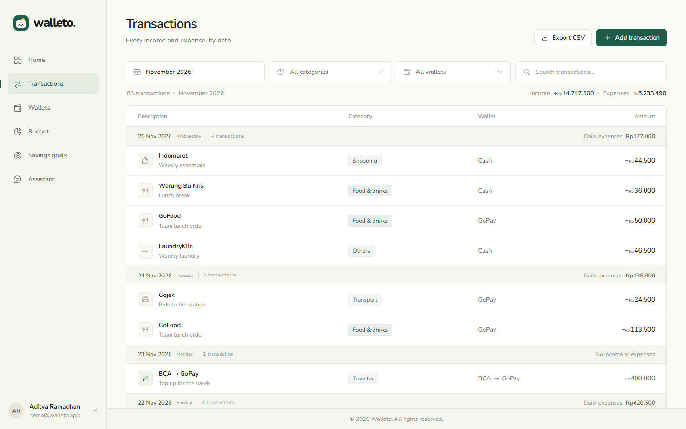
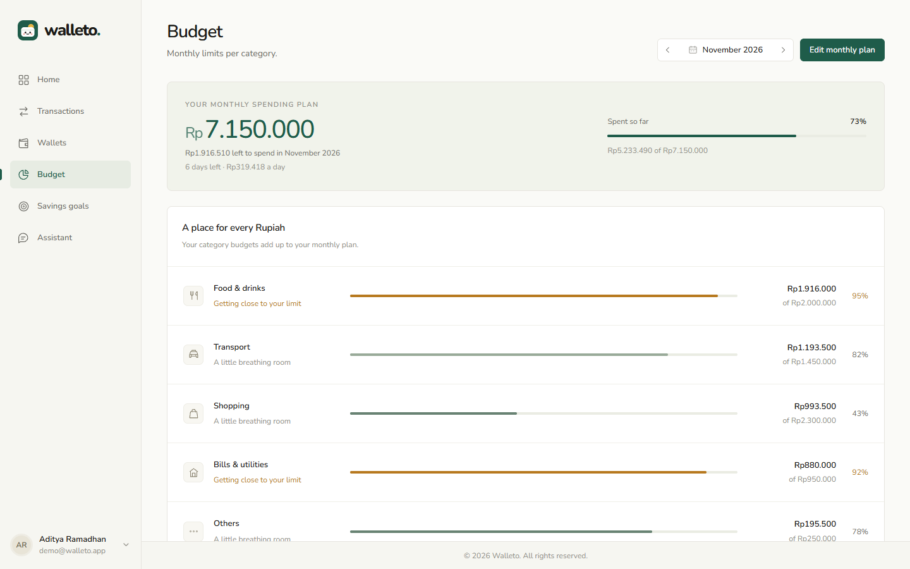
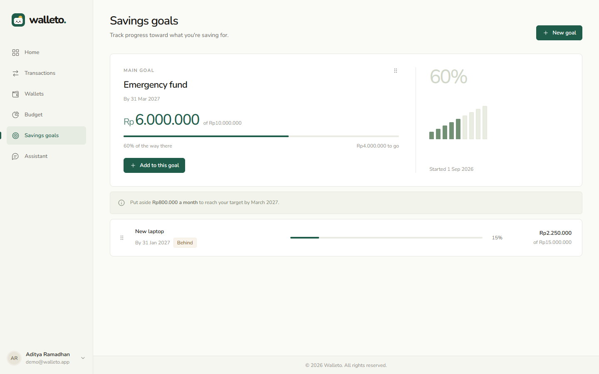
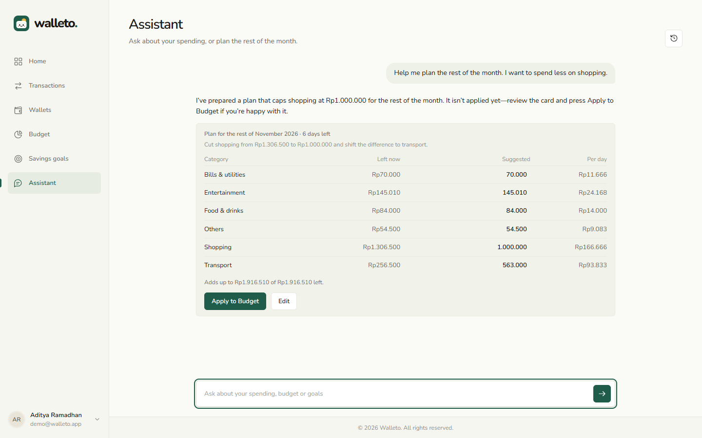
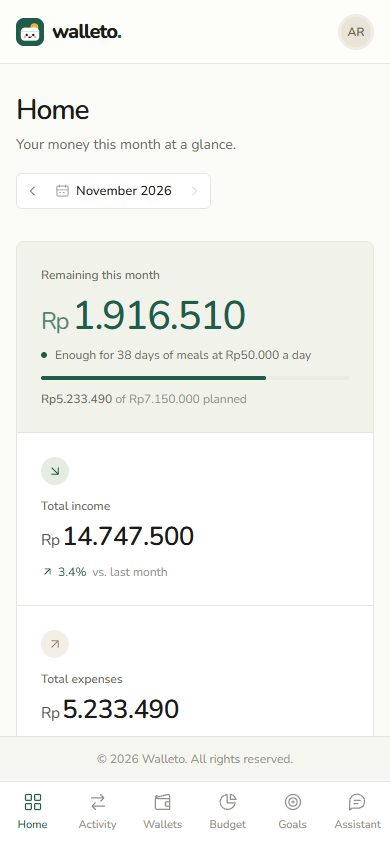
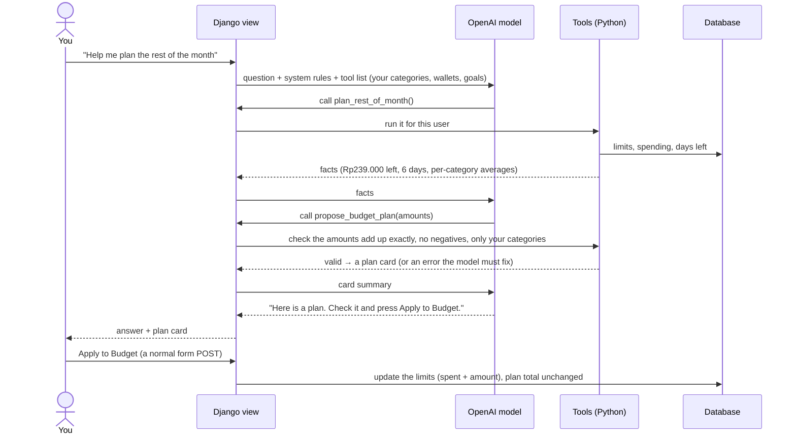
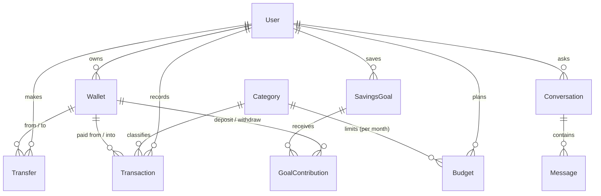

# Walleto

A personal finance web app for everyday life in Indonesia. You can record spending across wallets, set a budget per category, save toward goals, and ask an AI assistant about your own money. The assistant answers only from your data, and the numbers are always computed by code, never by the model.

**Live demo:** _coming soon_. Choose **Try demo account** on the sign-in page to explore three months of sample data without signing up.



## Features

| Page | What it does |
|---|---|
| **Home** | Remaining budget this month, income and expenses compared with last month, daily spending against the daily budget, and spending by category. Works for any month or date range. |
| **Transactions** | Income and expenses grouped by day, with daily totals, filters by date, category, wallet and text, and CSV export. |
| **Wallets** | Cash, bank and e-wallet balances with a 30-day balance chart. Transfers between wallets are not counted as spending. |
| **Budget** | A limit per category per month. "Edit monthly plan" rescales every limit, warnings start at 85%, and limits can be copied from last month. |
| **Savings goals** | Targets with deadlines. Deposits come out of a wallet, and each goal shows whether it is on track. |
| **Assistant** | Answers questions about your spending, budget and goals, and records transactions after you confirm them. It can also plan the rest of the month (applied to Budget only when you say so) and write a monthly PDF report. |

| Transactions | Budget |
|---|---|
|  |  |
| **Savings goals** | **Assistant: a plan for the rest of the month** |
|  |  |

On phones the sidebar becomes a bottom navigation bar:



## How the assistant works: the LLM picks tools, code computes

The model never does arithmetic on your money. It chooses a tool and fills in its arguments. Plain Python runs the tool against your own data, and the model then writes one or two sentences around the result. The figures you see in the cards come straight from the tool, not from the model's text.



These rules hold throughout:

- **Numbers come from code.** Totals, budgets, plans and report figures are computed by the same functions the pages use, so the assistant and the pages always agree.
- **Nothing changes without you.** Recording a transaction or applying a plan produces a card first. Only your click saves it, and each card can be used once.
- **Checked output.** A proposed plan that doesn't add up is sent back to the model with the difference. In the PDF report, the model's summary paragraph is checked so that every Rupiah amount and percentage matches the computed figures. If one doesn't match, a summary written by code is used instead.
- **Your data only.** Tools receive names (a category, a wallet, a goal), not IDs, and look them up only in your own records. Asking about investments or stocks is declined.
- **Limits.** A question may use at most 4 tool rounds, and each user may ask 30 questions a day.

### Evaluation

`python manage.py eval_assistant` sends 28 questions in English and Indonesian to the model and scores the first tool call. It checks the right tool, the right arguments and the right refusals. The latest run, with `gpt-6-luna`:

| Check | Result |
|---|---|
| Passed | **27 of 28** |
| Tool chosen correctly | 24 of 24 |
| Arguments correct | 23 of 24 |
| Refused correctly (investment questions) | 4 of 4 |

The one miss: for "How much did I spend this month?" the model leaves out `kind: "expense"`. Without it the tool returns both income and expenses, so the answer is still right. Every run, with each case, is in [docs/eval_results.md](docs/eval_results.md).

## Data model



- **Money is stored as whole Rupiah** in integer columns, never floats.
- **Balances are computed, not stored.** A wallet's balance is its starting balance plus income, minus expenses, plus or minus transfers and goal movements. This makes it impossible for a balance to disagree with its history.
- **The monthly plan is the sum of the category limits** and is not stored separately.
- **User data is always read through `for_user()` querysets.** One user can never read or change another user's data, even by guessing an ID in a URL: the app answers "Page not found". Tests check this for the pages and the assistant tools.

## Tech stack

- **Backend:** Django 5.2 with server-rendered templates and Django's own authentication.
- **Frontend:** Tailwind CSS v4, HTMX 2 for partial updates and Alpine.js for small interactions. There is no JavaScript framework, and every form still works without JavaScript. ApexCharts draws the savings goal chart, and the other charts are plain HTML.
- **AI:** the OpenAI API (Chat Completions with tool calling), called directly through the official SDK, without LangChain.
- **PDF:** xhtml2pdf, which is pure Python, so it also runs on Windows.
- **Database:** SQLite for development, PostgreSQL ([Neon](https://neon.tech)) in production.
- **Hosting:** [Render](https://render.com), with gunicorn and WhiteNoise.
- **Planning:** [OpenSpec](https://github.com/Fission-AI/OpenSpec), with one change per milestone. See [the project structure](#project-structure).

## Running locally

You need Python 3.11 and Node.js 20 or newer. Node is only used to build the Tailwind stylesheet.

```bash
git clone <this repository> walleto && cd walleto

# Python environment
python -m venv .venv
source .venv/bin/activate            # Windows PowerShell: .venv\Scripts\Activate.ps1
pip install -r requirements.txt

# Settings: copy the example, then set SECRET_KEY (any long random string) and DEBUG=True
cp .env.example .env                 # Windows: copy .env.example .env

# Database
python manage.py migrate

# Stylesheet: build once, or keep `npm run css:watch` running in another terminal while editing
npm install
npm run css:build

python manage.py runserver
```

Then open http://127.0.0.1:8000, and either create an account or choose **Try demo account**.

- **AI features:** the Assistant needs `OPENAI_API_KEY` and `OPENAI_MODEL` in `.env`. Without them, the page says it is not set up, and the rest of the app works normally.
- **Demo data:** `python manage.py seed_demo` creates or resets the demo account (`demo@walleto.app`) with three months of transactions, budgets and goals. Other users are not touched.
- **Tests:** `python manage.py test` runs the whole suite, more than 500 tests, in under a minute, and needs no API key.
- **Style guide:** `/styleguide/` shows every shared component. It is only available while `DEBUG=True`.

## Deploying

Walleto runs on Render's free web service with a free Neon PostgreSQL database, both in Singapore. [docs/DEPLOY.md](docs/DEPLOY.md) walks through it step by step: creating the database, the web service settings and environment values, the first-deploy checklist, updating, refreshing the demo data and troubleshooting.

`build.sh` is the whole build: install packages, build the CSS, collect the static files and migrate.

## Project structure

```
accounts/     sign-in, registration, the demo sign-in; the email-based User model
finance/      wallets, categories, transactions, transfers, budgets, savings goals, the dashboard
              summary, the demo data (finance/demo.py) and most of the pages
assistant/    the tool registry (tools.py), the conversation loop (agent.py), the OpenAI client
              (llm.py), rest-of-month planning and PDF reports, and the evaluation command
core/         the app shell: sections, toasts, money formatting, error pages, middleware
config/       settings (all from environment variables), URLs, WSGI
templates/    Django templates; components/ holds the shared pieces
static/       src/app.css (Tailwind source), js/app.js, fonts, images, vendored HTMX/Alpine/ApexCharts
evals/        assistant.jsonl, the evaluation questions and expected tool calls
docs/         eval_results.md, DEPLOY.md, screenshots/
openspec/     specs/ (what the app must do, per capability), changes/archive/ (one plan per
              milestone: proposal, design, tasks), commits/ (a record per commit)
```

### How OpenSpec is used

Every milestone started as an OpenSpec change:
- a **proposal** (why, and what is out of scope);
- **spec deltas** (requirements with scenarios);
- a **design** (decisions, and the alternatives that were rejected);
- **tasks**, each with its own check.

After implementation, the change is archived and its requirements are merged into `openspec/specs/`, which now describes 13 capabilities. `openspec/commits/` explains, for each commit, what was built, why, and how it was verified.
